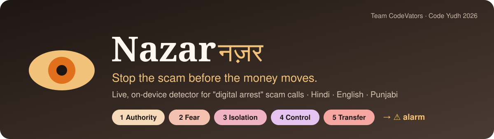
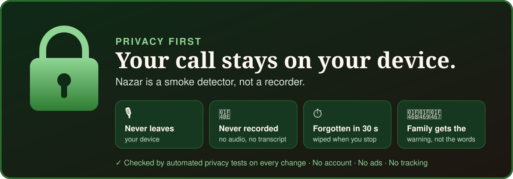
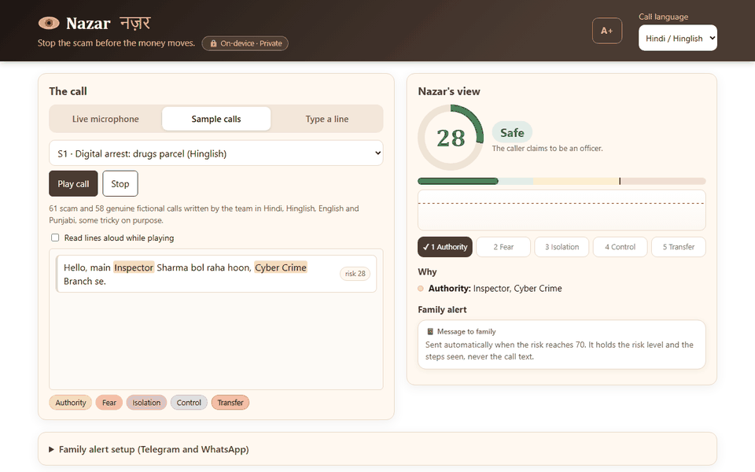
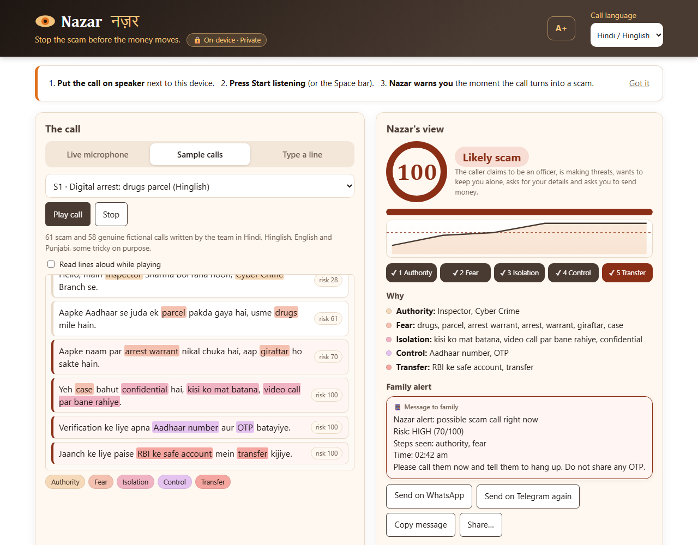
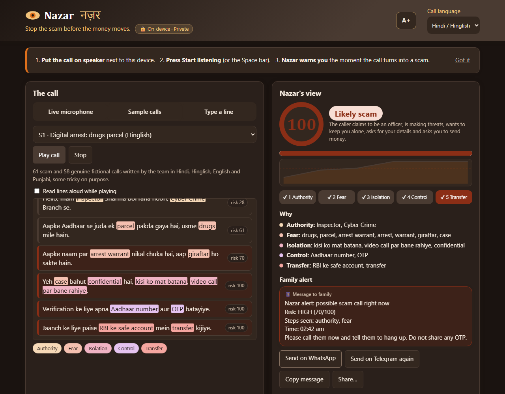
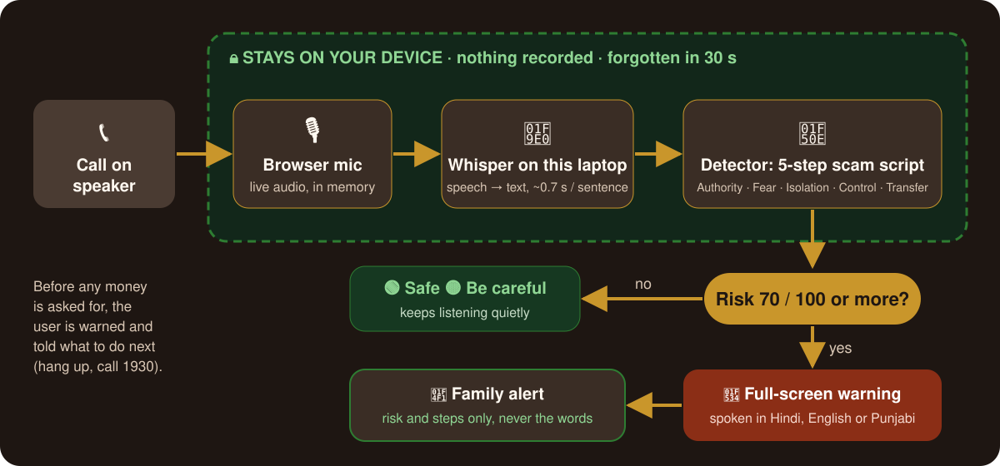

<p align="center">
  
</p>

<p align="center">
  <a href="PRIVACY.md"></a>
</p>

<p align="center">
  <a href="https://nazar-codevators.vercel.app"></a>
  <a href="https://github.com/Kunal039/Nazar_CodeVators/actions/workflows/test.yml"></a>
  <a href="LICENSE"></a>
</p>
<p align="center">
  <a href="PRIVACY.md"></a>
  <a href="server/test_privacy.py"></a>
</p>
<p align="center">
  
  
  
</p>

<p align="center">
  <b>Nazar</b> (नज़र, "watchful eye") listens to a phone call on speaker and warns you, in your language,
  the moment it turns into a <b>"digital arrest"</b> scam — <b>before any money is asked for</b>.
</p>

<p align="center">
  
  <br><sub>Sample call S1: the risk rises with each line and the alarm fires at line 3, before the caller asks for money.</sub>
</p>

<p align="center">
  <a href="README.hi.md">हिन्दी</a> ·
  <a href="#-your-privacy-comes-first">Privacy</a> ·
  <a href="#-the-problem">Problem</a> ·
  <a href="#-how-it-works">How it works</a> ·
  <a href="#-results">Results</a> ·
  <a href="#-privacy-by-design">Privacy</a> ·
  <a href="#-quick-start">Quick start</a> ·
  <a href="#-team">Team</a>
</p>

---

## 🔒 Your privacy comes first

Nazar listens to phone calls, so privacy is the rule everything is built around:

- 🎙️ **Your call never leaves your device.** Speech is turned into text on your own laptop; the speech server cannot even be reached from the network.
- 💾 **Nothing is recorded or saved.** No audio files, no transcripts. Each sentence is discarded once it has been checked.
- ⏱️ **Nazar forgets as it goes.** After 30 seconds only scam warning words are kept; pressing Stop wipes everything.
- 👨‍👩‍👧 **Your family is told *that* it is a scam, never *what* was said.**
- 🚫 **No account, no ads, no tracking.**
- ✅ **Tested, not just promised:** privacy tests run on every change and fail if any of this is broken.

Full details, including the one exception (the website's optional cloud speech, used only if you choose it): **[PRIVACY.md](PRIVACY.md)**

## 🚨 The problem

In a "digital arrest" scam, a caller poses as CBI, police, customs or a court, says you are part of a crime,
keeps you "under arrest" on a video call so you can't talk to anyone, and makes you transfer your savings to a
"safe account". Victims, often older people, lose crores every year, and by the time family finds out the money is gone.

Every one of these calls follows the same script. **Nazar recognises the script while it is happening.**

## 🖼️ Screenshots

| Scam detected | Dark mode |
|---|---|
|  |  |

## ⚙️ How it works

<p align="center">
  
</p>

Every digital-arrest call moves through five steps. Nazar scores each one as the call goes on:

| Step | What the caller does | Example cues (Hindi · English · Punjabi) |
|---|---|---|
| **1 Authority** | Claims to be CBI, police, customs, court, bank | सीबीआई, inspector, ਪੁਲਿਸ |
| **2 Fear** | A case, arrest warrant, drugs, money laundering | अरेस्ट वारंट, drugs parcel, ਨਸ਼ਾ |
| **3 Isolation** | Don't tell anyone, stay on video, don't hang up | किसी को मत बताना, stay on the call, ਕਿਸੇ ਨੂੰ ਨਾ ਦੱਸਿਓ |
| **4 Control** | Asks for OTP, Aadhaar, card, account details | ओटीपी, card number, ਆਧਾਰ ਨੰਬਰ |
| **5 Transfer** | Move money to a "safe" or verification account | सेफ अकाउंट, RBI escrow, ਸੇਫ ਖਾਤਾ |

Steps closer to the money count more, the scam's usual order adds a bonus, and the alarm fires at **70/100**.
Smart rules keep genuine calls quiet:

- 🗣️ **Aimed at you?** Threats count only once the caller addresses the listener (you, आप, tusi, ਤੁਸੀਂ). A news report *about* a scam stays calm.
- 🛡️ **Scam awareness:** a bank warning about scams, or anyone mentioning the 1930 helpline, gets a caution at most. "This is not a scam" does *not* count: scammers say it too.
- 🔤 **One word list for every script:** Gurmukhi and Devanagari are folded together, along with spelling variants and words Whisper mishears (ग्रग → drugs, वोरेंट → warrant).

Details: [scoring](docs/scoring.md) · [architecture](docs/architecture.md)

## 📊 Results

| Test | Result |
|---|---|
| Digital-arrest scam calls (54, incl. Whisper-style transcripts) | **54/54 caught, all before money was asked for** |
| Genuine calls (58, incl. hard ones: bank warnings, lawyers, reporters) | **57/58 stay quiet** · 1 known limit ([G49](docs/known-limits.md)) |
| Recorded phone-quality calls through Whisper on GPU | Hindi and Punjabi scams alarm at sentence 3; genuine call stays safe |
| Speed (Whisper large-v3-turbo, laptop GPU) | **~0.7 s per sentence** |

All test calls are fictional and written by our team, so these are not real-world accuracy numbers. Run them yourself with `npm test`.

## 🔒 Privacy by design

> **A smoke detector, not a recorder.**

| Promise | How |
|---|---|
| Audio never leaves the device | Whisper runs locally; the server listens on 127.0.0.1 only |
| Nothing is recorded | Audio is transcribed in memory, sentence by sentence, then discarded |
| Short memory | After 30 s a line keeps only its scam phrases, or nothing |
| Wiped when the call ends | Stopping listening forgets all call text |
| Alerts carry no conversation | Family sees risk level, steps and time, never what was said |

More: [PRIVACY.md](PRIVACY.md) · technical notes in [docs/privacy.md](docs/privacy.md)

## ✨ Features

- 🎙️ **One big button** to start listening (or press Space), with a live loudness bar and call timer
- 💍 **Risk ring**, step tracker and a plain sentence: *"The caller claims to be an officer and is making threats."*
- 🔴 **Full-screen spoken warning** in Hindi or English, then **what to do next** (1930, cybercrime.gov.in)
- 📱 **Family alert** via WhatsApp, Telegram, copy or share, without any call text
- 🌐 Hindi, English, Hinglish and Punjabi · **A+ large text** · **dark mode** · screen-reader friendly
- 📲 **Installable app**, works offline · 🧪 built-in **test bench** with 119 calls

## 🚀 Quick start

**Private, on-device version (Windows, NVIDIA GPU recommended):**

```bash
pip install -r server/requirements.txt
start.bat            # or: python server/server.py
```

Chrome opens http://localhost:8000. Set the call language, press **Start listening**, and play a call on speaker
(try [`demo-audio/S1_full.wav`](demo-audio)).
Shareable demo moments: [`?call=S1&upto=3&alarm=1`](https://nazar-codevators.vercel.app/?call=S1&upto=3&alarm=1) shows the alarm on line 3. Works with Wi-Fi off. Full steps: [demo guide](docs/demo-guide.md).

**Website version:** https://nazar-codevators.vercel.app, with sample calls, typed lines and browser speech (Chrome/Edge).

**Tests:**

```bash
npm test                          # detector, scoring, folding, listener and awareness tests
python server/test_cutter.py      # speech server sentence cutting
node web/e2e_live.js demo-audio/S1_full.wav   # recorded call through Whisper (server running)
```

## 🗂️ Repository

```
web/          the page and the detector (runs in the browser and in Node)
server/       on-device Whisper speech server (FastAPI + WebSocket)
demo-audio/   phone-quality demo calls
stt-bench/    speech-to-text benchmark (Whisper sizes, CPU vs GPU)
docs/         privacy, scoring, architecture, results, FAQ, presentation
```

## 🧭 What was built when

| Part | Origin |
|---|---|
| `web/` detector, UI, sample calls, test bench | Started as our **Phase 1 online-round prototype**, committed here as the starting point |
| `stt-bench/` speech-to-text benchmark | Pre-event research, committed as-is |
| On-device speech server, privacy features, new rules, 64 new test calls, the redesigned UI, tests and CI | **Built at the venue, 27–28 Oct 2026** (see the commit history) |

## ⚠️ Known limits

- One genuine call (a lawyer asking a client to keep a court settlement confidential) raises the alarm: [known limits](docs/known-limits.md).
- Lottery, job-fee and fake-relative scams are outside the digital-arrest pattern and are not flagged yet.
- On a real phone, call audio needs a dialer app or telecom partner; the demo listens on speaker.

## 👥 Team

**Team CodeVators** · Code Yudh 2026 final, Chandigarh University

| | |
|---|---|
| **Kunal Mittal** | Team lead · [@Kunal039](https://github.com/Kunal039) |
| **Ansh Kumar** | Team member |
| **Shivani Kumari** | Team member |

If you get a call like this: **hang up, don't pay, call 1930**, or report at [cybercrime.gov.in](https://cybercrime.gov.in).

<sub>MIT licensed · [Contributing](CONTRIBUTING.md) · [Security](SECURITY.md) · [Changelog](CHANGELOG.md)</sub>
